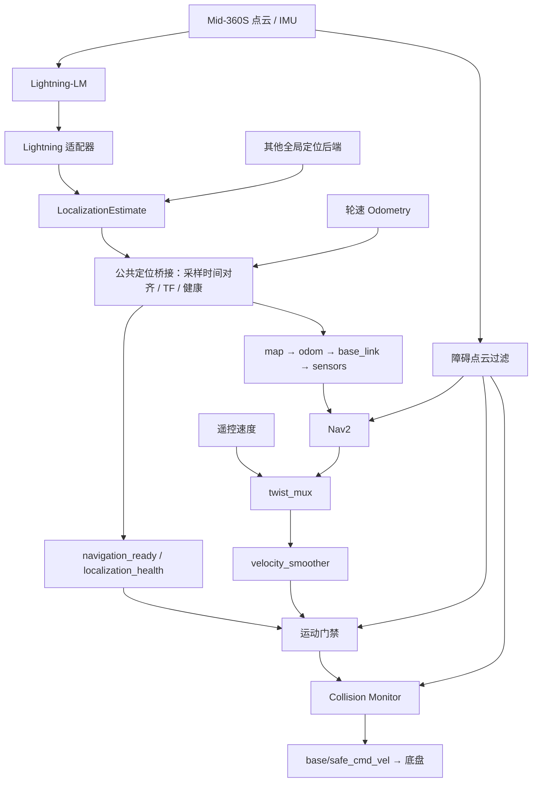

# Ranger Mini 导航系统

面向 **AgileX Ranger Mini V2 + Livox Mid-360S** 的 ROS 2 导航工程，包含传感器与底盘集成、Lightning-LM 建图和定位、Nav2 平地导航、安全速度链及离线验证工具。

项目采用独立节点、后端适配器和统一配置组织各模块，目标是在更换定位或建图算法时，保持导航、安全门禁和底盘接口稳定。

## 当前进展

| 模块 | 当前状态 |
| --- | --- |
| 底盘与雷达 | 已有通信、收流和录包的阶段证据；实际启动仍需按本次测试确认 |
| 建图与定位 | 当前使用 Lightning-LM；已有地图、离线运行及静止冷启动定位记录 |
| 公共定位接口 | 已分离 Lightning 适配器、标准位姿/健康消息和公共 TF 管理 |
| 时间对齐 | 按定位原采样时间插值轮速位姿，处理延迟、断流和时间回退 |
| 会话管理 | 默认 dry-run，具备依赖就绪检查、资源互斥、子进程清理及故障停机 |
| Nav2 与安全链 | 配置和隔离离线验证完成，完整真机导航验收仍为 **PARTIAL** |
| 后续工作 | FAST-LIVO2 接入准备、传感器同步与精确标定、高程地图旁路验证 |

详细事实、历史记录和待验项见 [项目状态](docs/STATUS.md)。合成测试通过不代表实际停车距离、定位精度、窄口通行或坡道能力已经验收。当前规划模型包含现场窄口实验参数，不能直接作为实物碰撞包络使用。

## 软件与硬件

- 本机已验证环境：Ubuntu 22.04、ROS 2 Humble、系统 Python 3.10。
- 底盘：Ranger Mini V2，`ranger_ros2` + `ugv_sdk`。
- 雷达：Livox Mid-360S，Livox-SDK2 + `livox_ros_driver2`。
- 当前建图/定位：Lightning-LM。
- 导航：Nav2，Smac Hybrid-A* + MPPI。
- 可视化：Foxglove Bridge，可按配置关闭。

相机驱动存在于本机独立工作空间；相机同步、内外参及 FAST-LIVO2 接入尚未完成本项目验收。高程地图后端当前禁用。

## 架构



`standard` 后端接收外部发布的标准定位消息；它是接入接口，不是另一个现成定位算法。当前连续里程计仍来自轮速，建图与全局定位分工独立。

| 公共接口 | 用途 |
| --- | --- |
| `/wheel/odom` | 连续轮速里程计及速度 |
| `/localization/estimate` | 地图系车体位姿、原采样时间和后端状态，类型为 `ranger_localization_msgs/LocalizationEstimate` |
| `/navigation_ready` | 公共就绪信号，供安全门禁使用 |
| `/localization_health` | 对齐、新鲜度和后端状态诊断 |
| `/livox/obstacles` | 过滤后的障碍点云与新鲜度心跳 |
| `/base/safe_cmd_vel` | Collision Monitor 最终输出的底盘速度入口 |

公共桥接负责 `map→odom` 与 `odom→base_link`；Lightning 原生位姿使用私有 `lightning_imu_pose`，避免与物理传感器 TF 争夺发布权。详见 [定位接口契约](docs/localization_backend_contract.md)。

## 目录

```text
config/       运行配置、地图关联、传感器与底盘配置
docs/         阶段报告、操作说明、验证证据
scripts/      启动、构建、采集、诊断和会话管理入口
patches/      第三方源码的本项目修改
tests/        定位契约、时间对齐、进程管理及安全链验证
maps/         地图实验产物、来源和验收记录
ws_nav/src/   本项目维护的 ROS 2 包
  ranger_localization_msgs/    标准定位消息
  ranger_localization_bridge/  公共桥接及 Lightning 适配器
  ranger_navigation/           Nav2 配置、门禁和障碍点云过滤
```

本机另有 `ws_base/`、`ws_livox/`、`ws_slam/`、`ws_camera/`、`vendor/` 和 `bags/`。这些目录以及构建产物、`.runtime/` 不随本仓库上传；**克隆仓库不包含完整运行环境和原始 rosbag**。

## 获取与构建

```bash
git clone https://github.com/Ecust-Robotics-Lab/ranger-mini.git
cd ranger-mini
```

第三方源码需要按固定上游版本恢复，并结合 `patches/` 重现本地修改。版本和本地分支记录见 [基线报告](docs/architecture_baseline.md)及 [版本快照](docs/architecture_evidence/batch1_20261019/baseline.json)；上游起点还记录于 `config/base_sources.repos` 和 `config/livox_sources.repos`。本机的 `ranger-local` 提交不保证存在于上游仓库。

现有 `build_base.sh`、`build_livox.sh` 等阶段脚本带有固定版本检查；恢复源码时应先核对脚本要求和对应阶段报告。它们不是全新机器的一键安装程序。迁移目录时还需核对算法原生配置中的地图及依赖路径。

在 ROS Humble、Livox 自定义消息及所需导航依赖已经就绪后，于项目根目录构建集成包：

```bash
source /opt/ros/humble/setup.bash
source ws_livox/install/setup.bash
cd ws_nav
PYTHONDONTWRITEBYTECODE=1 colcon build --packages-up-to ranger_navigation --executor sequential
source install/setup.bash
cd ..
```

各阶段环境与依赖说明见 [底盘报告](docs/02_base_interface.md)、[雷达报告](docs/03_mid360_validation.md)、[Lightning 报告](docs/04_mapping_report.md)和 [Nav2 报告](docs/06_flat_navigation_acceptance.md)。

## 配置与启动

主要配置入口：

| 文件 | 内容 |
| --- | --- |
| [`config/runtime.yaml`](config/runtime.yaml) | 后端选择、定位阈值、历史缓存、外参近似值与初始位姿 |
| [`config/maps/field_20260928.yaml`](config/maps/field_20260928.yaml) | 原生定位地图、导航地图、标定来源和源包关联 |
| [`config/field_session.env`](config/field_session.env) | 现场组件开关及受支持的环境覆盖 |
| [`ws_nav/src/ranger_navigation/config/`](ws_nav/src/ranger_navigation/config/) | 导航、仲裁、门禁与防撞参数 |

地图关联清单不代表地图已全部验收；验收结论保留在每个地图实验的 `acceptance.json` 中。安装外参当前仍为近似值。

先检查配置和启动计划，以下命令不启动节点：

```bash
python3 scripts/runtime_config.py
bash scripts/field_session.sh
bash scripts/run_navigation.sh
```

现场、导航、底盘、雷达和辅助入口均默认 dry-run。实际执行为前台受管会话；含底盘或导航的启动必须取得该次测试的明确确认，并显式传入 `--execute --control-authorized`。该标志不等于运动使能，重启也不继承运动许可。完整操作流程见 [受管会话说明](docs/managed_sessions.md)和 [工程约束](AGENTS.md)。

查看及停止本管理器创建的会话：

```bash
bash scripts/field_session.sh --status
bash scripts/run_navigation.sh --status
bash scripts/run_navigation.sh --stop
bash scripts/field_session.sh --stop
```

会话日志、状态和事件记录在 `.runtime/sessions/<会话>/run-*`。管理器按进程身份清理所属子进程，不自动重启；它不会代替操作员处理外部手动启动的旧进程。

## 离线验证

最近一次完整回归于 2026-10-20 完成；2026-10-26 恢复中断后复跑了时间对齐和进程管理。证据见 [第三批报告](docs/architecture_batch3_report.md)。

| 验证项 | 结果 |
| --- | --- |
| 时间对齐与延迟轨迹 | 7/7 |
| 进程管理与故障清理 | 11/11 |
| 定位接口契约 | 11/11 |
| 定位桥接 | 14/14 |
| 门禁运动学单元 | 12/12 |
| Nav2 安全链 | 37/37 |
| 合成传感器驱动实际启动入口 | 生命周期就绪、输入中断停机及子进程清理通过 |

不依赖 ROS 的进程管理测试可直接运行：

```bash
PYTHONDONTWRITEBYTECODE=1 python3 tests/test_session_manager.py
```

在前述集成包构建完成并加载 ROS / 工作空间环境后，可运行定位与门禁验证：

```bash
PYTHONDONTWRITEBYTECODE=1 python3 tests/test_time_alignment.py
PYTHONDONTWRITEBYTECODE=1 python3 tests/test_architecture_contract.py
PYTHONDONTWRITEBYTECODE=1 python3 tests/test_stage5_bridge.py
PYTHONDONTWRITEBYTECODE=1 python3 tests/test_stage6_gate_unit.py
```

ROS 集成测试使用独立 domain、localhost 和合成输入，不连接物理底盘。全栈安全及受管入口测试还依赖本机 Nav2 和 Livox 消息环境，执行方法、失败尝试与边界见报告；本 README 不把这些结果作为真机通过证明。

## 后续路线与文档

1. 已完成：基线梳理、定位接口与配置解耦、采样时间对齐、受管会话。
2. 下一批：FAST-LIVO2 实现和版本审查、职责划分、同步/标定缺口及离线接入方案。
3. 后续：高程地图旁路验证，再按阶段补齐实际导航和坡道能力验收。

- [架构改造计划](ARCHITECTURE_PLAN.md)
- [项目状态与待验项](docs/STATUS.md)
- [定位后端接口](docs/localization_backend_contract.md)
- [会话操作与故障边界](docs/managed_sessions.md)

项目维护：[ujd66](https://github.com/ujd66) · [Ecust Robotics Lab](https://github.com/Ecust-Robotics-Lab)。
