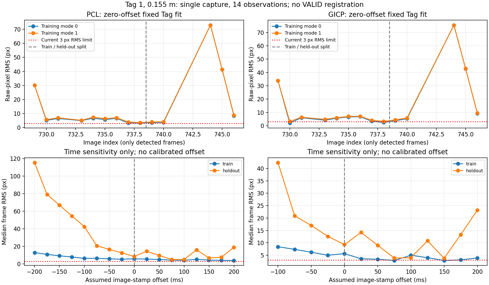

# AprilTag 旧地图补录可行性评估

日期：2026-10-29。范围：用户要求“先来评估试试”；随后确认 Tag 固定，并表示可以重新录制。仅离线评估，没有启动设备或生成真实 VALID 地标。

**结论：现包可用于软件联调，但目前不足以正式登记可用定位地标。** 用户已确认 tag36h11:1、黑白边界边长 0.155 m、采集期间固定未移动。14 次观测都有健康的既有 C1 支持，但双解、有限平移视差及固定地标跨帧重投影不一致仍未解决。不能把这归结为标签移动，也不能仅凭残差判定是时偏或外参单一问题。

## 1 输入与方法

复用 [全包提取](fast_livo2_apriltag_fullbag_report.md) 的 1367 帧结果，其中 14 次 Tag 观测集中在约 1.700 s。保留全部 28 支有效单帧假设；原包本轮无需再次读取或回放。固定性声明保存为 [用户声明](fast_livo2_evidence/apriltag_landmark_assessment_20261029/fixedness_declaration.json)，属于用户部署信息，不是独立计量结果。

本轮复用已有 PCL/GICP 两套 C1 的 `result.json`、`samples.jsonl`，没有重新启动定位节点。它们绑定同一个旧 `native_frames` 数据库，SHA256 为 `2eecd2c75e0c33eac80cda41f043f4c8ebe6bd5c089da06e6018b40deeaf62b4`。使用全包提取中的 `replay_odometry.jsonl`，不混入原包在线 odometry 或新重力对齐轨迹。

| 输入地图 | UUID | 图版本 | manifest SHA256 |
| --- | --- | --- | --- |
| PCL | `6acd0a5763786389402bf72f397d9cbc` | 62 | `a890afe331f16ad5d65e601f390a00c7f270cd489346884a41b0b4274b9a4f58` |
| GICP | `ba6fc8f61218a477d21da5e2b8afff43` | 62 | `7abc51e21a5e3fd62ba8fc119c64a78a1aa4e5ca8dd8c44bb1aebf760dfdd546` |

两份地图各 151 个 manifest 成员逐文件 SHA 校验通过，同时检查 COMMITTED；地图、标定和原始观测不改写。旧地图没有重力对齐，地图 z 不能解释为外部竖直高度。

统一 `T_A_B` 将 B 系点变到 A 系。取图像时刻 `tc` 之后首个可信 C1 扫描时刻 `ts`，检查连续三次 C1 健康状态和修正连续性，然后计算：

```text
T_M_C(tc) = T_M_I(ts)_C1 * inverse(X(ts)) * X(tc) * T_I_C
T_M_F_observation = T_M_C(tc) * T_C_F(tc)
```

`X(t)` 仅在同一旧前端局部轨迹的包围样本间做平移插值和旋转 SLERP，int64 纳秒保存时刻，禁止外推；没有在跳变的地图轨迹上插值。C1 位姿来自实际 `quality.T_target_source`，不是虚构的顶层 pose 字段。两图独立处理，不能跨 UUID 平均。

单帧地图候选先按姿态模式聚类，每幅图在每模式至多一票。对前 9 帧拟合一个固定 Tag 位姿，后 5 帧仅检查：固定轨迹、外参、内参和假设时偏，**不优化前端轨迹或 C1**。使用原始像素域 K/D 及原角点，拟合仅作诊断，不写入地标库。种子也只来自训练帧。该划分仍是一次访问的相关帧，不等于独立访问验收。

## 2 实际结果

| 项目 | PCL | GICP |
| --- | --- | --- |
| 有健康段支持的 Tag 观测 | 14/14 | 14/14 |
| 选用 C1 扫描 RMSE | 0.0457–0.0611 m | 0.0455–0.0607 m |
| 选用 C1 source overlap | 1.000 | 0.9993–1.000 |
| 相机最大两两平移基线 | 0.0394 m | 0.0418 m |
| 相机最大两两旋转 | 12.96° | 12.92° |
| 对 Tag 中心的最大视线变化 | 1.18° | 1.28° |
| 单帧候选姿态模式 | 2，各 14 帧支持 | 2，各 14 帧支持 |
| 两模式朝向差 | 61.48° | 61.48° |
| 两模式中心位置差 | 0.00382 m | 0.00395 m |
| 零时偏、训练误差较低分支：训练帧 RMS 中位数 | 5.71 px | 5.61 px |
| 同分支：留出帧 RMS 中位数 / 最大值 | 8.44 / 72.91 px | 9.26 / 75.50 px |

14 次观测实际挂载到 11 个不同 C1 扫描，最大挂载时间差 100.32 ms；这不是默认同戳或最近帧。11 个扫描中 1 个本来就是归档关键帧，且整个 C1 与建图使用同一包，因此这些几何统计不能当独立地图精度证据。

单帧各自求 pose 时残差较小，不代表沿轨迹能得到一个跨帧一致的固定地标。两模式位置接近但法向显著不同，不能把姿态平均成“唯一地标”。当前运动支持规则计得 3 组（平移或旋转），仅按 0.15 m 平移间隔则只有 1 组；这说明转动不等于获得足够平移视差，该计数也不是独立访问数。0.15 m、姿态聚类阈值及像素门槛都是本次诊断/现有初始配置，不是普适验收标准。



## 3 时偏敏感性

从本包图像 header 推得中位采样周期 99.84 ms；以四分之一周期步长，检查 ±2 周期的 17 个假设偏移，定义 `t_effective=t_header+offset`。不是照旧记录硬编码 ±100 ms。每个偏移独立重新关联，仍要求健康段和包围插值。

- PCL 17/17 个偏移可评估；GICP 13/17，可用范围之外的 4 个负偏移因既有 C1 未几何确认而拒绝，没有绕过状态检查。
- 正偏移改善部分残差。例如 +99.84 ms、按训练误差选种子，PCL 留出帧 RMS 中位数/最大值为 4.85/9.66 px，GICP 为 4.00/9.77 px。
- 本次所有可评估偏移和种子中，**0 组能让全部 14 帧通过现有 3 px RMS / 6 px 最大角点误差检查**；这两个门槛本身尚待真实数据标定。
- 该短窗不足以辨识时间、外参、轨迹和角点误差的各自贡献。没有选择、保存或宣称校准时偏；`offset_ns=0`、`time_verified=false` 保持。不能拿留出帧最优值当独立时偏真值。

## 4 软件检查与命令

新增 [assess_landmark.py](../scripts/fast_livo2/tags/assess_landmark.py)，默认 dry-run，拒绝覆盖现有输出目录；产物明确标记 `apriltag_landmark_assessment_not_map_extension`，始终不执行注册。旧 C1 保存记录缺显式 session/request ID，本工具明确记录缺失，不伪造可用于正式 builder 的 `segment_verified` provenance。

实际执行，均退出 0：

```bash
PYTHONDONTWRITEBYTECODE=1 python3 tests/test_fast_livo_tag_assessment.py

PYTHONDONTWRITEBYTECODE=1 /usr/bin/time -v python3 -u \
  scripts/fast_livo2/tags/assess_landmark.py --execute \
  --fixedness-declaration docs/fast_livo2_evidence/apriltag_landmark_assessment_20261029/fixedness_declaration.json \
  --output outputs/fast-livo-apriltag-landmark-assessment-20261029

PYTHONDONTWRITEBYTECODE=1 python3 \
  docs/fast_livo2_evidence/apriltag_landmark_assessment_20261029/plot_assessment.py
```

[6 项测试](../tests/test_fast_livo_tag_assessment.py)覆盖：大历元、非交换旋转/平移/杆臂及不同采样时间；不健康/错图/缺局部位姿拒绝；地图修正跳变与禁止外推；独立 Brown 投影真值的训练/留出恢复；矛盾留出帧拒绝；镜像模式隔离和同图去重。测试日志在 [tests.log](fast_livo2_evidence/apriltag_landmark_assessment_20261029/tests.log)，评估日志在 [assessment.log](fast_livo2_evidence/apriltag_landmark_assessment_20261029/assessment.log)。评估进程耗时 1.80 s，峰值 RSS 187412 KiB，是本次小型诊断资源记录。既有 123 项及全包 4 项属于此前通过证据，本轮没有冒充重跑。

[最终核对](fast_livo2_evidence/apriltag_landmark_assessment_20261029/verification.json)记录输入地图/C1 SHA、配置未变、dry-run 不落盘、Python 语法、文档链接与 `git diff --check` 通过。受管预览已 STOPPED；C1/C2 为此前故障测试遗留 FAILED，三者均 `live=false, owned=[]`，本轮没有重启。

## 5 交付状态与下一步

**PASS**：固定性用户声明归档；14 次观测的健康 C1 段关联；两份地图成员 SHA；双模式隔离；固定轨迹留出检查和时偏敏感性诊断；新增 6 项测试。

**PARTIAL / 未验证**：物理曝光对应、外参计量精度、足够平移视角和唯一位姿、正式补录所需完整会话来源、独立访问/绝对精度。实际跨帧一致性未满足当前检查条件，登记结论为 **NOT_READY_FOR_VALID_REGISTRATION / AMBIGUOUS**。这是数据与关联条件评估结果，不是将评估脚本成功运行写成地标通过。

**未实施**：真实 VALID 地标表、C2/B 对真实 Tag 的定位或回环提交、调大阈值、修改标定/时间映射/生产开关、设备采集与运动、Git 提交/推送。

用户愿意补录，新包有助于解决平移视角和独立验证不足，但不应带着未核实的同步假设直接重复同一路径。建议顺序：

1. 先核对现有外触发/曝光设置、同步 CSV 与图像 header 的物理对应及 Camera–IMU 外参来源，决定需要保留的同步证据。现包时偏扫描只作线索，不把约 +100 ms 写成补偿。
2. 记录仍固定、唯一的 `tag36h11:1`，边界尺寸 0.155 m；保持同一地图版本与完整标定、图像、CameraInfo、IMU、LiDAR、连续前端位姿及同步日志。新录制若启用当前重力对齐前端，应作为独立会话通过既有 C1/C2 对齐旧地图，不能直接套用本次旧轨迹变换。
3. 在 Tag 清晰可见时，从左/中/右、近/远多个位置慢速观察，获得数十厘米至约米级的实际相机平移、适度斜视和短暂停留，减少运动模糊；这是采集设计建议，不是通用质量阈值。避免只在约 2 m 处原地转动后迅速离开画面。
4. 登记和验证分成两次独立访问/包。登记访问建立候选并通过固定性、模式和回投验证；第二次重新接近、改变位置/朝向，用于独立恢复评测。无需预先承诺成功率或绝对精度。

本轮停在离线评估边界，不启动这些采集动作。完整候选姿态、角点来源、逐帧 C1 支持和分支误差见 [本机输出](../outputs/fast-livo-apriltag-landmark-assessment-20261029/assessment.json)；可随 Git 保存的摘要和图表位于 [证据目录](fast_livo2_evidence/apriltag_landmark_assessment_20261029/assessment.json)。
