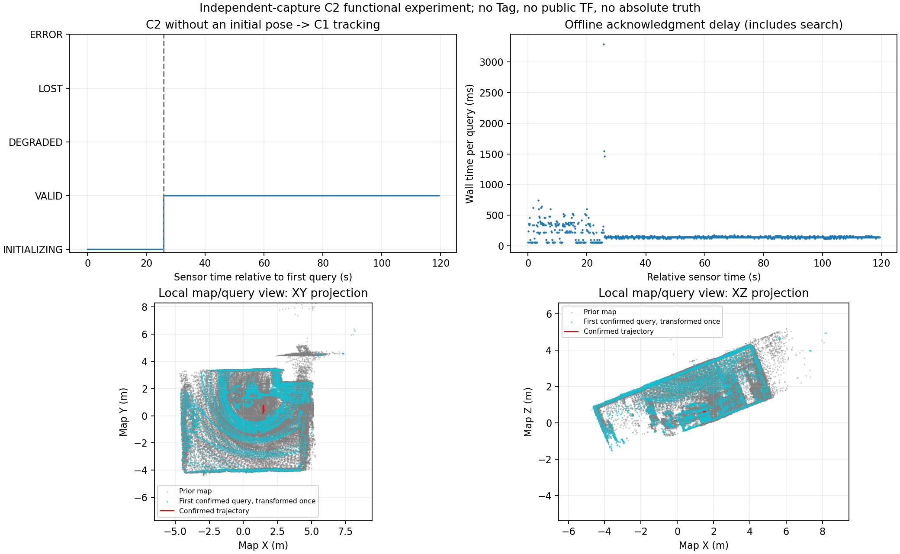
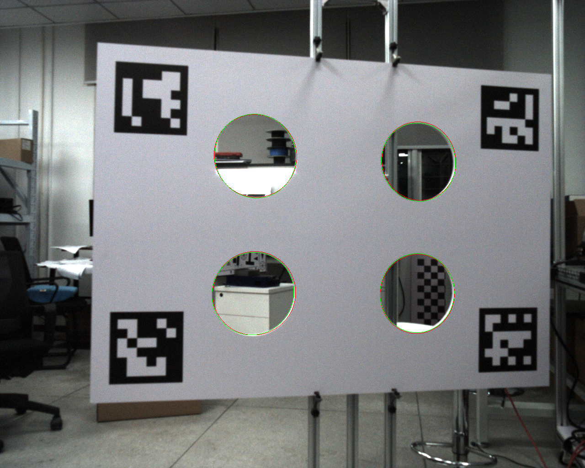

# 独立采集数据的 C2 全局重定位与标定复核

日期：2026-11-04。用户要求继续排查，并询问何时开始全局定位测试。本轮已经实际执行了无人工初值、Tag 候选关闭的 C2 全局重定位：旧 B 地图与新录制查询分开，首次由 C2 发现候选、验证运动支持、交给 C1，再持续跟踪。**这条纯 LiDAR 候选路径不需要等待 Tag 标定全部完成。** FAST-LIVO2 前端仍保留 LiDAR/IMU/Camera 三融合，不能把“Tag 关闭”称为关闭相机。

**结果：1195 对查询全部处理，约第 25.90 秒首次进入 VALID，之后 936 个采样有效，LOST/ERROR 均为 0。** 这是一次不同录制包的离线功能试验；用户后续已确认同一场地，但旧图完整覆盖与独立位置真值仍缺，不能据内部配准通过宣布绝对位置正确或给出精度/泛化成功率。没有启动设备、底盘、公共定位桥接或导航，没有提交/推送。

## 1 输入和授权范围

本报告完成后的用户补充（2026-11-04）：已确认新旧包在同一场地，并说明旧图无 Tag。原话归档于[同场地声明](fast_livo2_evidence/tag_motion_geometry_20261104/user_site_declaration.json)。这不改变原始评估快照，也不自动补足完整地图覆盖/独立位姿真值；旧图没有 Tag 扩展与本次关闭 Tag 的 C2 功能试验兼容。

| 项目 | 实际输入 |
| --- | --- |
| 先验地图 | `outputs/fast-livo-backend-validation-20261028-pcl/snapshot/`；49 个关键帧，151 个归档文件校验通过 |
| 地图来源 | 历史 `bags/fast-livo-motion-w5phdosj` 的 B 归档；源 manifest SHA `a890afe331f16ad5d65e601f390a00c7f270cd489346884a41b0b4274b9a4f58` |
| 查询来源 | 用户新录 `bags/fast-livo-tag140_sync_diag_02-35f_m8nd/`，与建图采集不同；没有把旧图关键帧直接当查询 |
| 查询前端 | 上轮当前锁定源码的独立重放、原零时偏；1195 对 VIO 后 IMU 位姿与单区间 body 云，严格同戳 |
| 查询 native DB | `outputs/fast-livo-tag140-sync-diag02-replay-current-20261104/0/result/native_frames/`；SHA `083196bd30ed96ac81368864ce96e2b7089ea9ae26ed7e91ae54966875f38513` |
| 算法 | 原 C2 检索 / KISS 完整六自由度粗配准 / PCL ICP / 原几何门控和运动确认 / 同一个 C1 跟踪 |
| 坐标 | 旧图未对齐重力，新查询已对齐；使用原完整六自由度匹配，没有默认只估 yaw 或强行旋转旧图 |
| 隔离 | ROS_DOMAIN_ID=193、ROS_LOCALHOST_ONLY=1、use_sim_time；不发布 wheel、公共 TF 或速度 |

旧地图缺完整来源身份的问题仍由显式离线兼容说明处理。新 [compatibility.json](fast_livo2_evidence/c2_cross_session_20261104/compatibility.json)绑定同一个 manifest SHA，保留物理同步/精度未验证和来源不完整的限制；原兼容说明、原地图和采集包未改写。[输入关系声明](fast_livo2_evidence/c2_cross_session_20261104/input_relation.json)说明是不同 capture，同时明确地图空间重叠尚未获用户确认，不把“不同包”偷换为“正确地点已验证”。

## 2 C2 首轮和完整运行

先对前 300 对输入做就绪/候选/交接检查，成功后扩展至全部 1195 对。两次都没有发送 Initialize 初值，也没有启用任何 Tag 配置或观察器。C2 前段拒绝把静止重复观测当成独立运动支持，达到原门槛后才确认。

| 指标 | 前 300 对 | 完整 1195 对 |
| --- | --- | --- |
| 输入/实际处理 | 300/300 | 1195/1195 |
| INITIALIZING / VALID 采样 | 259 / 41 | 259 / 936 |
| 首次 VALID | 零基 index 259 | 零基 index 259，传感器时间 +25.900230169 s |
| LOST / ERROR | 0 / 0 | 0 / 0 |
| 丢失/恢复事件 | 首轮未发生 | 0 / 0；本包没有验证真实 LOST 后恢复 |
| 最终状态 | VALID | VALID |
| localizer 退出码 / 评估退出码 | 0 / 0 | 0 / 0 |
| 评估墙钟 | 78.215 s | 209.970 s |
| localizer 峰值 RSS | 199524 KiB | 192456 KiB |
| 有效跟踪配准耗时 P50/P95/最大 | 首轮结果另存 | 87.546 / 104.915 / 1429.427 ms |
| 输入确认等待 P50/P95/最大 | 首轮结果另存 | 140.459 / 361.129 / 3287.367 ms |
| 公共 `/tf`、`/tf_static`、`/cmd_vel`、`/base/safe_cmd_vel` | 发布者均 0 | 发布者均 0 |

25.90 s 包含开始静止、候选拒绝和运动基线等待，不是一个独立算法的纯耗时。输入按每帧确认节流，墙钟和等待时间不代表实时吞吐或实车延迟。936 是后续有效跟踪采样数，不是 936 次独立全局恢复。

完整结果：[zero_full_result.json](fast_livo2_evidence/c2_cross_session_20261104/zero_full_result.json)；精简事实：[baseline_summary.json](fast_livo2_evidence/c2_cross_session_20261104/baseline_summary.json)。原 `samples.jsonl` 位于本机完整输出目录，包含原戳、确认戳、候选质量、map/session/generation、估计的 `T_map_imu` 和原因。



下方点云图只显示首个恢复位置附近的局部视图；灰色先验图、青色独立查询云（按确认位姿只变换一次）、红色确认轨迹。地图轴按原旧图坐标显示，不追认 +Z 已对齐；显示裁剪不参与算法门槛。叠加与地图残差属于内部一致性证据，没有独立真值时不能当作 APE/RPE 或绝对位置精度。

## 3 已有独立标定记录复核

同时使用未参与三场景外参拟合的 `calibration/lidar_camera_extrinsics/datasets/validation_01/20261021_185640_899318/bag`，固定原 `T_cam_lidar` 和归档五参数内参，没有重新拟合外参。

本次增加直接图像边界检查：相机图中的 ArUco 只用于为四孔选择宽 ROI；实际 Canny 边缘先转换到去畸变像素域，稳健拟合孔边界椭圆。LiDAR 用既有离线诊断器的 50 帧平面/圆心，加已确认的名义孔半径构造三维圆，经固定外参投到同一个去畸变域，比较曲线到观测椭圆的距离。没有把 ArUco 推算的孔中心当独立像素真值，也没有把透视下的三维圆心投影误当椭圆中心。

| 孔（板坐标顺序） | 曲线距离 RMS | P95 | 图像边缘支持 |
| --- | --- | --- | --- |
| 0 | 1.062 px | 1.768 px | 507 像素，33/36 角度区间 |
| 1 | 1.805 px | 2.780 px | 562 像素，35/36 区间 |
| 2 | 1.427 px | 2.090 px | 553 像素，35/36 区间 |
| 3 | 2.430 px | 4.070 px | 596 像素，36/36 区间 |

静态独立场景中的投影总体重合，没有据此将正式外参状态改成 PASS。这些距离仍混合 LiDAR 圆心/平面提取、名义半径、图像边缘拟合等误差；一个静态板姿态不验证动态曝光相位，也不能排除所有视角下的外参误差。[完整摘要](fast_livo2_evidence/c2_cross_session_20261104/heldout_calibration_summary.json)。



绿色是实测图像边界拟合，红色是固定外参的 LiDAR 圆模型预测，叠加图重新畸变回原始像素域。原标定结果、原 bag、前端参数和 Tag time_verified 均未修改。

## 4 工具的最小改动与验证

复用 [validate_motion.py](../scripts/fast_livo2/localizer/validate_motion.py)，没有改 C2/C1 算法、配准实现或生产阈值：

- 增加可选 `--query-provenance`，在启动 ROS/子进程前校验声明的地图/native DB SHA；独立 capture 不允许走同图推导初值的 C1 分支。未提供时兼容原工具。
- 增加 `--allow-recovery`，仅用于 C2 评估如何判定包含 LOST 后恢复的试验：仍要求无 ERROR、结束 VALID、没有未完成恢复和公共输出；默认保持原严格无 LOST 判定。它不改变节点状态机、锁或确认门槛。本次 LOST=0，因此没有用这个选项掩盖跟踪丢失。
- 每帧额外记录估计位姿和地图/会话/请求代际，以及丢失/恢复事件计数，方便审查。

新增 [5 项测试](../tests/test_fast_livo_global_evaluation.py)：错误地图/查询 SHA 拒绝、独立输入禁止同图初值、旧调用兼容；有杂边的旋转椭圆恢复、短弧拒绝；透视圆心与椭圆中心差异。日志：[evaluation-tests.log](fast_livo2_evidence/c2_cross_session_20261104/evaluation-tests.log)，5/5、退出 0。未为本轮未改变的 C2 算法重复跑全部旧回归。

实际命令（仓库根目录，均已执行）：

```bash
source /opt/ros/humble/setup.bash
source ws_fast_livo/backend_install/setup.bash
export LD_LIBRARY_PATH=/home/lab307/ranger_nav/ws_fast_livo/backend_deps/lib:$LD_LIBRARY_PATH
PYTHONDONTWRITEBYTECODE=1 OMP_NUM_THREADS=1 OPENBLAS_NUM_THREADS=1 \
python3 scripts/fast_livo2/localizer/validate_motion.py --execute \
  --global-search --allow-recovery --domain 193 --initial-index 0 \
  --query-provenance docs/fast_livo2_evidence/c2_cross_session_20261104/input_relation.json \
  --archive outputs/fast-livo-backend-validation-20261028-pcl/snapshot \
  --compatibility docs/fast_livo2_evidence/c2_cross_session_20261104/compatibility.json \
  --native outputs/fast-livo-tag140-sync-diag02-replay-current-20261104/0/result/native_frames \
  --output outputs/fast-livo-c2-cross-session-20261104-zero-full

PYTHONDONTWRITEBYTECODE=1 python3 \
  docs/fast_livo2_evidence/c2_cross_session_20261104/check_calibration.py --execute
PYTHONDONTWRITEBYTECODE=1 python3 tests/test_fast_livo_global_evaluation.py
PYTHONDONTWRITEBYTECODE=1 python3 \
  docs/fast_livo2_evidence/c2_cross_session_20261104/summarize.py
```

输出已存在，复现须选新输出位置；标定检查脚本当前输出名固定，也会拒绝覆盖。完整运行退出 0，[zero-full.log](fast_livo2_evidence/c2_cross_session_20261104/zero-full.log)；首轮退出 0，[zero-first300.log](fast_livo2_evidence/c2_cross_session_20261104/zero-first300.log)。独立板检查和摘要/作图均退出 0，[heldout-calibration.log](fast_livo2_evidence/c2_cross_session_20261104/heldout-calibration.log)。[dry-run](fast_livo2_evidence/c2_cross_session_20261104/global-dryrun.json)退出 0、没有启动进程。源码基线/备份见 [baseline.json](fast_livo2_evidence/c2_cross_session_20261104/baseline.json)，最终校验见 [verification.json](fast_livo2_evidence/c2_cross_session_20261104/verification.json)。

## 5 什么时候测什么

| 测试 | 当前状态 / 下一步条件 |
| --- | --- |
| 纯 LiDAR 候选 C2 的真实数据离线全局定位 | **已经开始并完成本次流程试验**；旧图与新包分离，无人工初值，持续跟踪通过 |
| “是否恢复到真实正确地点”的验收 | 先确认本包确实位于旧图覆盖区，并结合场地/已知位置或外部参考核对恢复位置；补不同起点、真实相似地点和地图外负样本。现有一次内部通过不能代替这些检查 |
| Tag 辅助全局恢复 | 需要有证据的时间映射/不确定性、与源图 UUID/几何版本匹配且通过验证的 VALID Tag 表，再用独立访问做恢复/拒绝测试；当前两项仍未完成，Tag 默认关闭 |
| 实车私有定位和公共桥接 | 后续按该次明确设备授权开展；公共链还需同刻 wheel 时钟、实际 `T_base_imu` 和现有创新锁规则。传感器旧历元不能直接拼 wheel/主机时钟 |
| Nav2 行驶 | 属于 D，须在定位/桥接和安全链验收后取得该次明确运动授权；本轮没有执行 |

不再把所有 Tag 标定问题设为纯 C2 测试的前置条件，也不通过放宽 Tag 门槛强行开始 Tag 真实定位。现有包足以继续软件核查；本轮最少人工待办是确认场地覆盖并核对恢复位置，暂不因动作顺序不同要求再录包。

**PASS**：本轮 C2 无初值发现→原门控→C1 交接/跟踪流程；1195 对完整输入、936 有效采样、无 LOST/ERROR/公共输出；5 项新测试；独立板检查执行及来源保留。

**PARTIAL / 未验证**：实际地点正确性/绝对精度、跨场景泛化、真实地图外负样本与真实丢失恢复、物理同步/动态外参质量、实时接车和长时运行。工具保留 `independent_session_validated=false`，避免仅因不同 capture 和内部通过就宣布这些验收完成。

**未实施**：Tag VALID 地图登记、启用 Tag 候选、实机时间/零偏/外参变更、安装/部署新前端、真实设备/底盘动作、公共桥接接管、Git 提交/推送。

## 展示素材

2026-11-04 按用户要求将真实数据整理为 [4 张 PNG 与建议图注](../outputs/fast-livo-apriltag-presentation-20261104/README.md)，[打包 ZIP](../outputs/fast-livo-apriltag-presentation-20261104/presentation_images.zip)。前三张为1920×1080中文展示版，分别展示C2状态/点云、实际Tag角点/双解、时偏实验；第四张保持独立标定板原投影图。图注保留离线功能/实验候选/未验绝对精度的范围，不改变原测量或结论；来源摘要和重绘脚本同目录保存。
