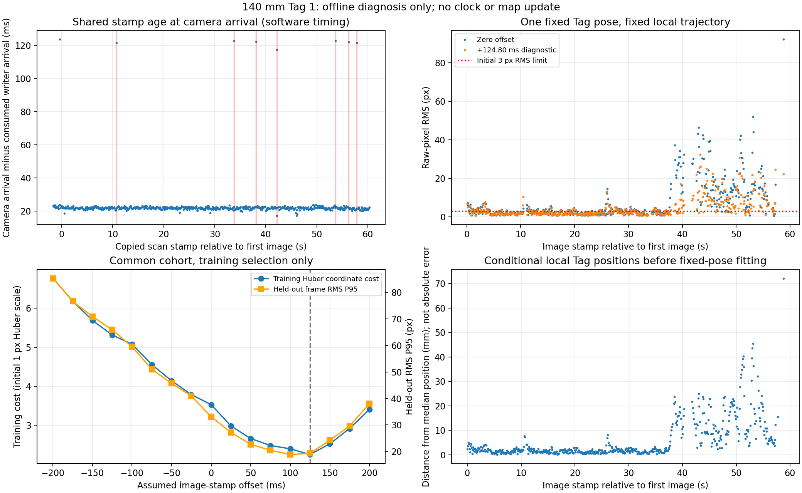

# 140 mm Tag：同步对应与固定地标跨帧一致性

日期：2026-10-29。用户授权先完成同步和跨帧一致性两项离线分析，并明确确认本次 Tag 1 在整个录制期间固定未移动。输入为 `bags/fast-livo-tag140_check_01-dguhgx2l/` 与 [此前全量筛查](fast_livo2_tag140_check_report.md)。没有启动设备、回放 ROS graph、改变运行配置、登记地标或提交 Git。

**结论：同步重复戳已定位到 writer 接收链漏掉扫描；固定地标跨帧检查仍未满足当前条件。** 这份数据有继续分析价值，但尚不能登记 VALID 地标。诊断中正向时偏能改善运动段残差，仍不能据此认定一个真实曝光补偿值。

## 1 输入、版本与边界

- 新包为 0.140 m 的 tag36h11:1；旧包 0.155 m、旧地图/轨迹均未参与计算。
- 新标签固定性为本轮用户声明，保存在 [fixedness_declaration.json](fast_livo2_evidence/apriltag_tag140_consistency_20261029/fixedness_declaration.json)。用户随后确认相机与雷达刚性固定、安装位置自标定后未改变，140 mm 为打印后实测黑色外边界尺寸，追加保存于 [setup_declaration.json](fast_livo2_evidence/apriltag_tag140_consistency_20261029/setup_declaration.json)。这是用户提供的实物信息，不是本分析独立计量；原分析输入及其 SHA 保持不变。
- 读取录制时归档的相机 K/D、T_IMU_Camera 和 provenance；没有使用事后参数重解释历史图像。原图域为 raw/plumb_bob，保留全部两支假设。
- 原包 SHA256 在分析前后均为 `190637437b9cd7cb8e27ca4cda3168cc59a6af11c425334bf12b44a330432479`。SQLite 使用只读/query_only。所有新输出写入独立目录。
- 本次原生前端是新重力对齐会话，只在自己的连续局部坐标 O 内分析。没有输出地图 M 的位姿或拼接旧地图，没有 C1 全局定位质量证据。

## 2 同步：已确认 writer 漏收，不是共享值变小

完整设备会话 CSV 有相机 621 帧、writer 629 条记录；正式 bag 中有连续的 600 个 LiDAR 扫描。相机 frame_id 连续，device ticks 单调。

将相机 `ts_seq` 与 writer `2*seq`、`ts_low_ns` 与 `scan_start_ns` 精确核对：621/621 均一致，且它们恰好是相机到达时 writer 已记录的最新序号。没有发现相机在已有更新时仍读旧值的证据。

正式录制窗口内，**7 个存在于 bag 的 LiDAR 扫描戳没有出现在 writer CSV**。每个缺口都位于一对约 200 ms 的 writer 扫描戳之间，并与一条相机 BACKWARD 逐一对应。相机在该周期读到前次相同 seq/stamp，随后恢复正常；录前另有一例相同模式，但缺失的扫描不在正式 bag 范围内。

| 相机 frame_id | 重复共享戳相对首图时间 | 后续 writer 戳间隔 | bag 有而 writer 缺少的扫描戳 ns |
| --- | --- | --- | --- |
| 125 | 10.700 s | 199.680 ms | 1590195580500244130 |
| 356 | 33.800 s | 200.160 ms | 1590195603600102540 |
| 399 | 38.100 s | 200.175 ms | 1590195607900481340 |
| 440 | 42.200 s | 199.695 ms | 1590195612000234810 |
| 555 | 53.700 s | 199.680 ms | 1590195623500236790 |
| 580 | 56.200 s | 200.175 ms | 1590195626000120820 |
| 596 | 57.800 s | 200.160 ms | 1590195627600455510 |

原 bag 的这些扫描已经存在，不能归因为雷达没有产生/发布扫描或 rosbag 漏录。writer 日志也逐次记录 stamp gap/arrival gap，但现有证据只能定位到 **writer 订阅/处理入口的缺失**，尚不能区分 DDS 丢失、接收队列或调度的具体成因。

源码核查：`ws_camera/src/timeshare_writer/src/timeshare_writer_node.cpp` 订阅使用 `KeepLast(5)`、`best_effort()`；录前图快照确认 LiDAR 发布者为 RELIABLE。当前订阅配置值得进行可靠 QoS 的独立负载对照，但归档没有完整运行时订阅端 QoS/丢包计数，不能只凭源码就宣称 BEST_EFFORT 是已证实的唯一根因。本轮没有更改 QoS、重启节点或改 v2 原子协议。

相机到达减对应 writer 到达的中位数为 **21.793 ms**，P95 23.041 ms；异常时最大 123.584 ms。相机到达后到同步发布的中位数为 4.172 ms。这些是主机软件处理时间，不是曝光中点与扫描的偏移。device ticks 与 steady 到达时间拟合的残差 P95 约 0.146 ms，说明到达序列相对稳定，也不能证明物理同步。

## 3 固定地标检查方法

统一 `p_A=T_A_B*p_B`。仅使用本包在线连续位姿 `X(t)=T_O_I(t)` 和归档外参 `E=T_I_C`：

```text
C(t) = T_O_C(t) = X(t) * E
F_observation = C(tc) * T_C_F(tc)
T_C_F_pred(tc) = inverse(C(tc)) * F_fixed
```

固定轨迹、外参、内参，只拟合一个 `F_fixed=T_O_F`，将四角用原始 K/D 投回 raw 像素域。没有联合优化轨迹、外参、尺寸或时钟来强行消除残差。新工具的向量化投影由独立 Brown 投影真值、非零旋转/平移与杆臂测试验证。

时间诊断定义 `t_effective=t_header+offset`。从实际 header 中位周期 99.84 ms 推得 ±199.68 ms、步长 24.96 ms 的 17 个偏移，不从旧记录硬编码补偿。每次使用同一前端会话的包围插值/SLERP，保留 150 ms 最大间隔和禁止外推。

556 次观测在零时偏下有 552 次可关联；17 个偏移均有合法支持的共同集合为 **528 帧**，所有偏移使用同一集合，避免可用帧变化影响比较。样本选择及被使用的原图索引保存在 [split.json](fast_livo2_evidence/apriltag_tag140_consistency_20261029/split.json)。

以 5 秒为时间块，块号模 3 等于 2 的内部帧作为留出；每块两端各排除 0.5 秒的训练/留出用途，训练帧最小间隔 0.5 秒。得到 **56 个训练帧、112 个留出帧**。边界帧仍计入全共同集合检查，没有静默删除残差差的帧。这是一次访问内部的时间留出，仍不代表独立访问。

两支假设先按训练观测形成姿态模式；本次各偏移均有 6 个训练模式，有界尝试前 4 个种子。4 个拟合最终收敛到数值相近的结果；剩余种子没有测试，不能声称已穷尽所有姿态。种子与偏移的诊断排序只使用训练集 Huber 目标值，留出帧不用于拟合或排序。

## 4 结果：固定时偏改善部分残差，仍不能登记

| 同一 528 帧、同一时间划分 | 零时偏 | +124.80 ms 假设偏移 |
| --- | --- | --- |
| 训练 Huber 坐标均值（1 px 初始尺度） | 3.529 | 2.252 |
| 训练帧 RMS 中位数 / P95 | 2.481 / 24.335 px | 2.319 / 19.037 px |
| 留出帧 RMS 中位数 / P95 | 3.539 / 33.102 px | 3.408 / 19.284 px |
| 留出帧 RMS 最大值 | 92.197 px | 32.366 px |
| 全集合通过当前 3 px RMS 且 6 px 最大角点误差 | 266/528 | 304/528 |
| 非正深度帧 | 0 | 0 |

`+124.80 ms` 是本次网格中**训练目标最低点**，不是已校准时偏。另一个 `+99.84 ms` 假设的留出 P95 为 18.890 px；不能看完留出后改选参数并称独立验证通过。所有检查门槛仍为此前的初始值，本轮没有放大阈值。

已测试的 17 个偏移及各 4 个种子，没有一个使全部共同集合帧通过当前检查。零时偏时，逐帧主假设折算的局部 Tag 位置相对其中位数离散度中位数约 2.07 mm、P95 22.39 mm、最大 72.13 mm；这些是内部离散度，不能报告为地图绝对精度。

误差在约 38 秒后的明显运动段增大。即便以训练目标最低的假设时偏诊断，在距离重复戳异常超过 0.5 秒的 **501 帧**中，仍有 **205 帧** RMS 超过 3 px，P95 15.291 px、最大 32.366 px。0.5 秒仅用于描述分层，不是新剔除规则。由此可见，漏收不是全部几何误差的解释。

用户已确认安装保持刚性且未改变、打印后实测边长为 140 mm，因此不再把安装后来变动或仅使用生成页面尺寸当作待确认原因。原试验标定准确性、曝光参考点、前端轨迹误差与图像运动模糊仍可能共同影响结果。本包的轨迹也使用过这些图像，不能视为独立外部真值；不应仅根据曲线就更改某个参数。



### 4.1 原因判断：证据强度与排查优先级

1. **已证实的局部问题：writer 接收/处理链缺扫描。** 原包有而 writer 没有的 7 个扫描，与录中 7 次重复共享戳逐一对应。相机对重复戳拒绝发布同步图像，是现有保护在起作用。当前 writer 使用 BEST_EFFORT、深度 5；这是排查点，并非已经证明的唯一丢失原因。[ROS 2 Humble QoS 官方说明](https://github.com/ros2/ros2_documentation/blob/humble/source/Concepts/Intermediate/About-Quality-of-Service-Settings.rst)明确 BEST_EFFORT 可丢失样本、RELIABLE 发布者可与 BEST_EFFORT 订阅者兼容；发布端可靠并不等于这个订阅端采用可靠交付。本包没有中间件丢失计数，无法继续归因到具体 DDS/调度机制。
2. **运动残差的首要工作假设：曝光与扫描起始戳的关联存在相位误差。** `ws_livox/src/livox_ros_driver2/src/comm/pub_handler.cpp:178` 组完一帧才发布，`src/lddc.cpp:298` 用 `pkg.base_time` 作 header；writer 复制该 header。相机 `hik_camera_node.cpp:2188` 则在收到图像后读取当前共享戳并直接赋给同步图像，没有触发编号到扫描编号的物理映射。外触发拍照、共享文件原子读取和正确曝光时间是三个不同条件。此实现可能将接近当前曝光的图像关联到已完成扫描的起始时刻，产生接近一周期的偏差；正向约 100–125 ms 假设改善运动段残差与此相符，但不是物理相位的证明，不能直接落成补偿。
3. **为何事后补时偏仍不够：作为参考的轨迹可能也受同一时间问题影响。** 前端 `LIVMapper.cpp:1055` 用图像时间切分 LiDAR/IMU，随后在该状态上融合图像。若输入图像时间不正确，原录制轨迹本身就可能含融合误差。当前诊断只改变 Tag 查询位姿的时刻，既不重跑前端，也不修正已经融合的轨迹，故不能把剩余残差直接归咎于外参。后续要用同一原包、独立输出的受控前端重放区分这两种影响，不联合拟合所有参数以凑低残差。
4. **第二层候选原因：原试验标定偏差、局部轨迹误差和运动模糊。** 刚性固定表示变换不随时间变化，不表示原数值已足够准确。既有 [试算报告](../calibration/lidar_camera_extrinsics/TRIAL_CALIBRATION_REPORT.md)明确独立几何验收未完成；单场景之间最大旋转差约 0.466°、平移差约 19.33 mm，只能作为敏感性线索，不能当本次外参误差。记录曝光为 20 ms，运动模糊值得检查，但尚无逐帧模糊归因证据。当前单帧 Tag 主假设像素拟合较好、跨帧运动段恶化，优先查时间与相对运动关系，不能把单帧小残差当标定准确的证明。

归因顺序为：writer 漏收链路的隔离对照，以及曝光/扫描时序和前端重放敏感性 → 独立标定投影检查 → 余下轨迹/运动模糊因素。缺少物理时间或独立几何证据时只报告假设支持程度，不报告根因已经全部解决。

## 5 实施、命令和证据

新增 [analyze_capture_consistency.py](../scripts/fast_livo2/tags/analyze_capture_consistency.py)，默认 dry-run、拒绝覆盖输出；只输出诊断 JSON，不是地图或时间映射格式。变更前备份/基线在 [baseline.json](fast_livo2_evidence/apriltag_tag140_consistency_20261029/baseline.json)。HEAD 仍为 `acffa879cc8d52330276089cd3df83ad6a43f112`。

实际执行，均退出 0：

```bash
PYTHONDONTWRITEBYTECODE=1 python3 tests/test_fast_livo_tag_consistency.py

source /opt/ros/humble/setup.bash
PYTHONDONTWRITEBYTECODE=1 /usr/bin/time -v python3 -u \
  scripts/fast_livo2/tags/analyze_capture_consistency.py --execute \
  --capture bags/fast-livo-tag140_check_01-dguhgx2l \
  --screen outputs/fast-livo-apriltag-tag140-check-20261029-v2 \
  --fixedness docs/fast_livo2_evidence/apriltag_tag140_consistency_20261029/fixedness_declaration.json \
  --output outputs/fast-livo-apriltag-tag140-consistency-20261029

PYTHONDONTWRITEBYTECODE=1 python3 \
  docs/fast_livo2_evidence/apriltag_tag140_consistency_20261029/post_analysis.py
```

新增 [5 项测试](../tests/test_fast_livo_tag_consistency.py)：writer 漏扫描导致重复共享戳；大历元下时间块隔离/边界清除/降采样；独立 Brown 投影及负深度；固定 Tag 恢复与矛盾留出拒绝；非匀速转弯加杆臂下已知时偏的正负方向。日志为 [tests.log](fast_livo2_evidence/apriltag_tag140_consistency_20261029/tests.log)，没有把先前测试冒充重跑。

分析命令耗时 6.78 s，峰值 RSS 208172 KiB；[完整日志](fast_livo2_evidence/apriltag_tag140_consistency_20261029/analysis.log)。[摘要](fast_livo2_evidence/apriltag_tag140_consistency_20261029/summary.json)、[逐异常对应](fast_livo2_evidence/apriltag_tag140_consistency_20261029/timing.json)、[残差分层](fast_livo2_evidence/apriltag_tag140_consistency_20261029/residual_stratification.json)及零/训练最低偏移的逐帧误差已归档。全部 17 个偏移的逐帧输出保留在本机 `outputs/fast-livo-apriltag-tag140-consistency-20261029/`。

补充声明后的收尾核查见 [verification.json](fast_livo2_evidence/apriltag_tag140_consistency_20261029/verification.json)：只做语法、dry-run、来源/配置摘要、外参转换及文档检查；上述 5 项测试沿用实际执行日志，没有将文档更新称为重跑测试。

## 6 交付状态与后续顺序

**PASS**：同步缺扫描与重复戳的精确对应；新标签固定性声明归档；同集合、分时块的固定轨迹诊断；5 项新测试；原包不变、默认配置保持。

**FAIL（本次数据的条件性检查）**：所测试固定轨迹/相机模型/时偏下，单一固定 Tag 未能让全部共同集合通过当前像素门槛。不是检测器未检出，也不是用户确认的标签移动；不据此放宽规则或生成 VALID 表。

**PARTIAL / 未验证**：运行时 writer 丢失的具体 DDS/调度成因、可靠 QoS 负载对照、曝光/扫描物理对应、外参与轨迹的独立误差、独立访问和绝对精度。刚性安装未改变与打印后实测尺寸已获用户确认。

**未实施**：修改 writer/相机驱动或 QoS、设定真实补偿值、改原包/标定/生产参数、建立全局地标表、C1/C2/B 提交、启动设备或底盘、Git 提交/推送。

安装/尺量信息已收齐。下一步优先做 writer 可靠订阅/负载的独立离线对照，以及曝光关联和前端重放的受控诊断，保留重复戳拒绝规则与失效诊断；不直接采用网格最优偏移。确认物理时间和跨帧一致性后再尝试 C1 旧地图补录；当前不急于仅为增加帧数而重录长包。后续独立访问包仍需另行采集。
