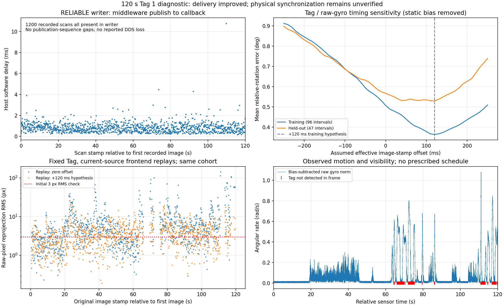

# 120 秒车载 Tag 同步诊断与受控重放

录制日期：2026-10-29；分析于当日开始，2026-11-04 中断后续完。输入：`bags/fast-livo-tag140_sync_diag_02-35f_m8nd/`。用户明确说前后移动和左右转向均已执行，但没有按预定顺序；本报告按实际图像/IMU 变化分析，不用动作表给数据贴真值标签。沿用已声明的固定 tag36h11:1、打印后实测黑边 0.140 m 和车载刚性安装信息；[声明来源](fast_livo2_evidence/tag140_sync_diag02_20261029/declaration.json)与独立计量有明确区别。

**结论：writer 漏收在本次实采中未复现；图像时间关联仍明显影响融合结果。+120 ms 仅为离线候选，尚不能作为已验收的实机补偿。** 当前源码重放中，候选使同一留出集合的重投影 RMS P95 从 27.569 px 降至 8.896 px，但仍未满足当前固定地标一致性检查。没有生成真实 VALID Tag 表、接入 C1/C2/B 提交或修改实机时偏。

## 1 原始数据、传输和可见性

原 DB 为 10,089,824,256 字节；筛查前后及 2026-11-04 复核 SHA256 均为 `753c9b4af470821d190c0187d920d9412a70f52ab774ff0adddec5e3d04589d2`。原包只读、原 header 不改。终端 observed_messages 含录前等待期间的消息，不是 DB 内数量。

| 项目 | 实际结果与含义 |
| --- | --- |
| DB 中 LiDAR / IMU | 1200 扫描 / 23999 样本；扫描时间连续，间隔约 99.840–100.335 ms |
| DB 中同步图像 / 原图 / CameraInfo / 在线 odometry | 各 1200；在线 odometry 与图像边界约差一帧，不默认索引配对 |
| writer 完整会话 | 1239 行；一个 publisher GID；publication sequence 无缺口；DDS lost 事件数为 0 |
| 相机完整会话 | 1224 帧均 OK；硬件帧号连续；每帧消费的共享 seq/stamp 均与当时最新 writer 样本精确一致 |
| 录中扫描对照 | 原 DB 的 1200 扫描全部在 writer 中，缺失 0；此前 60 秒包对应为缺失 7 |
| 发布至 writer 回调的主机软件延迟 | 中位 0.768 ms，P95 1.518 ms，最大 10.766 ms；完整设备会话统计 |
| 相机到达减消费的 writer 到达 | 中位 22.114 ms，P95 23.354 ms，最大 24.080 ms；属于软件时间，不是曝光偏移 |
| Tag 检测 | 1200 帧中 1067 帧检出，均为 tag36h11:1；这是帧检测占比，无人工标注不能称召回率 |
| 姿态歧义 | 1067 帧均保留两支 PnP；1016 帧两支都满足当前初始像素门槛，51 帧仅一支满足；没有提前丢弃次支 |
| 模型/位姿支持 | 归档 K/D 与全部 CameraInfo 一致；1065 次有本包连续局部位姿支持，边界 2 次禁止外推而拒绝 |

录前实际订阅图确认 writer 为 RELIABLE。图发现接口在本机将 history/depth 显示为 UNKNOWN/0，因此深度 5 的依据是归档 argv 和 writer 的实际 QoS 日志，不将发现接口的 0 当作真实队列深度。[传输摘要](fast_livo2_evidence/tag140_sync_diag02_20261029/delivery_summary.json)、[逐条软件时间对照摘要](fast_livo2_evidence/tag140_sync_diag02_20261104/imu_timing_summary.json)。

这是一份实采下的改善证据，不能推出今后永不丢失，也不能只因没有 BACKWARD 就认定物理同步通过。writer 可靠交付与曝光到扫描起始戳的映射仍是两个需要分别验证的条件。

## 2 独立于前端轨迹的转动诊断

新增 [analyze_imu_timing.py](../scripts/fast_livo2/tags/analyze_imu_timing.py)，只读 raw IMU 和已提取 Tag 姿态，计算约 300 ms 内的相对旋转；不积分平移、不建立新前端、不回灌任何状态。统一方向：

```text
R_C0_C1_visual = R_C0_F * transpose(R_C1_F)
R_C0_C1_gyro   = transpose(R_I_C) * R_I0_I1_gyro * R_I_C
t 偏移表示 t_effective = t_image_header + offset
```

按整数纳秒查询包围样本，旋转积分用相邻陀螺仪均值的 SO(3) 增量及 SLERP，最大 IMU 间隔 20 ms，禁止外推。相机旋转外参来自本包归档，不从 frame_id 推方向。时偏网格 −250 至 +250 ms、步长 10 ms，所有网格使用相同 322 个有效间隔。

间隔端点保留 1–2 支假设，最多四种组合。主统计按各图像自身像素误差排序，未用全局旧位姿选解；另保存每个偏移下的组合最小误差作为乐观下界。这个下界允许每个间隔独立选分支，不能当作已得到一致姿态轨迹或独立验证成功。

采用与驾驶动作无关的 20 秒时间块划分和边界清除；转动激励诊断条件为扩展窗口内 gyro norm P95 >0.1 rad/s，这是未实测标定的初始筛选值。得到训练 96、留出 47 个转动间隔。时间留出仍属于同一次采集，不是独立访问。

### 静态零偏对照

原始 gyro 在图像实际稳定时仍有非零输出，所以增加仅用于本次离线诊断的零偏敏感性检查。按四角的实测像素稳定性选择 5 秒窗：至少 45 帧、角点相对中位数的 RMS 离散度 P95≤0.2/max≤0.5 px，并检查 gyro 标准差；不根据预定动作表或前端速度推定静止。

实际训练窗为 0–5、5–10、10–15、90–95 s，共 3200 个去边界 IMU 样本；55–60 s 为留出静态窗。训练分量中位数约 `[0.029602, -0.012080, -0.025499] rad/s`，留出窗的分量中位数相同。此数是图像稳定条件下的诊断估计，没有写入 IMU/前端参数，也不能据此断言前端未估计零偏。

| gyro / Tag 主分支诊断 | 零假设时偏 | 训练选择 +120 ms |
| --- | --- | --- |
| 训练间隔平均旋转误差 | 0.507° | 0.363° |
| 留出间隔平均旋转误差 | 0.567° | 0.529° |
| 留出误差 P95 | 2.136° | 1.622° |

不去零偏时主分支训练最低为 +110 ms；去除诊断零偏后主分支最低为 +120 ms，分支下界最低为 +130 ms。留出曲线在一段正偏移范围内较平，各运动块的最低点也不完全一致。因此这些是“正向约一周期时差值得验证”的证据，不能声称唯一确定了曝光中心或已获得精确校准。后续重放固定使用训练主分支提出的 +120 ms，没有看完重放留出结果后重新选值。[零偏/转动完整摘要](fast_livo2_evidence/tag140_sync_diag02_20261104/imu_timing_summary.json)、[事后分块敏感性](fast_livo2_evidence/tag140_sync_diag02_20261029/motion_block_sensitivity.json)。

## 3 当前源码的双重放对照

中断前的两次安装版回放已正常结束，各 1195 对输出；结果与旧日志保留。续接发现安装回放程序和 vendor 中生成的回放/检查 harness 没有同步到项目现有源文件，输出缺少当前 harness 的重力对齐字段。因此没有据此追认当前源码行为，也没有覆盖安装二进制。

对 vendor 跟踪源码确认与锁定 commit/项目补丁完全一致后，复制到独立源码目录，使用 `scripts/fast_livo2/{replay.cpp,checks.cpp,input_guard.h}` 的当前内容生成 harness。独立构建目录为 `ws_fast_livo/build_sync_diag_current_20261104/`，未执行 install。日志路径也在这份源码副本下，避免覆盖原运行日志。源码清单、harness 差异及安装文件摘要见 [baseline.json](fast_livo2_evidence/tag140_sync_diag02_20261104/baseline.json)。

两组当前源码重放仅修改各自派生 trial.yaml 的 `time_offset.img_time_offset`：0 与 +0.120 s。输入仍为原 DB，其他归档配置相同，LiDAR/IMU/Camera 三融合全部开启，localhost/domain 181，无公共 TF。两组均输出 1195 个 VIO 后 IMU 位姿/云对，各自只执行一次初始重力对齐；初始重力为 `[约0,约0,-9.81]`，视觉更新次数分别为 5828 / 5709。原包没改戳，在线配置和安装二进制没改。

评价时，图像原戳 tc 对应 `X(tc+assumed_offset)*T_I_C`，不再额外重复补偿。两组分别拟合自己局部系内的一个固定 Tag，使用同一归档 raw 像素模型、同一训练目标和初始门槛。共同集合 1061 帧，103 个训练帧、274 个留出帧；拟合和有限种子选择均不使用留出帧。姿态种子仍有界尝试 4 支，不能宣称穷尽所有模式。

| 当前源码、同一 1061 帧 | 零时偏重放 | +120 ms 候选重放 |
| --- | --- | --- |
| 留出帧 RMS 中位数 | 4.427 px | 3.279 px |
| 留出帧 RMS P95 | 27.569 px | 8.896 px |
| 留出帧 RMS 最大值 | 108.119 px | 18.691 px |
| 全集合通过初始 RMS≤3 / 最大角点≤6 px | 383/1061 | 489/1061 |
| 进程退出码 | 0 | 0 |
| 进程墙钟 / 峰值 RSS | 约18.30 s / 705448 KiB | 约14.48 s / 703256 KiB |

时间假设明显减小尾部误差，支持“图像时间关联会影响前端融合”的判断。但未达门槛的观测仍很多，不能把一次软件假设试验认作物理同步或可靠地标已验收。剩余误差可能包括外参、图像模型/平面姿态歧义、轨迹和运动成像因素，本轮没有把它们一起优化来凑低残差。[同集合重放摘要](fast_livo2_evidence/tag140_sync_diag02_20261104/current_replay_evaluation.json)、[精简对照表](fast_livo2_evidence/tag140_sync_diag02_20261104/comparison_summary.json)。



## 4 软件修补与可追溯性

本包已有 writer/相机源码和二进制归档，但没有录制当时前端二进制。因此当前安装文件不能倒推证明当时前端与某份源码完全一致。最小补修为：录包 `snapshot_sources` 今后也保存实际 `fastlivo_mapping` 字节/SHA；既有有限录制测试同时核对该档案。没有替换当前部署程序。

新增分析脚本及 [6 项解析/独立运动测试](../tests/test_tag_imu_timing.py)，覆盖三轴非零运动与非单位外参、正确转动方向、已知正时偏、四分支保留、缺口/重复/NaN/禁止外推、恒角速度不可辨时偏、图像稳定而非预定顺序决定零偏窗且仅使用训练样本。图像检测、已有坐标/时间方法继续复用。

`.gitignore` 增加 `/outputs/fast-livo-tag140-*/`，仅使大体积派生输出留本机；小型摘要、命令和日志在 docs 中保存，没有删除任何输出、失败证据、原 bag 或地图。独立复核图同时保存 [PNG](fast_livo2_evidence/tag140_sync_diag02_20261104/diagnostic_results.png) / [SVG](fast_livo2_evidence/tag140_sync_diag02_20261104/diagnostic_results.svg)。

## 5 命令、退出码与检查

原先于 2026-10-29 执行的只读命令均退出 0，日志保留原时间：

```bash
source /opt/ros/humble/setup.bash
PYTHONDONTWRITEBYTECODE=1 python3 scripts/fast_livo2/tags/screen_capture.py --execute \
  --capture bags/fast-livo-tag140_sync_diag_02-35f_m8nd \
  --sizes config/fast_livo2/apriltag_sizes_capture_140mm.json \
  --output outputs/fast-livo-tag140-sync-diag02-screen-20261029
PYTHONDONTWRITEBYTECODE=1 python3 scripts/fast_livo2/tags/analyze_capture_consistency.py --execute \
  --capture bags/fast-livo-tag140_sync_diag_02-35f_m8nd \
  --screen outputs/fast-livo-tag140-sync-diag02-screen-20261029 \
  --fixedness docs/fast_livo2_evidence/tag140_sync_diag02_20261029/declaration.json \
  --output outputs/fast-livo-tag140-sync-diag02-consistency-20261029
PYTHONDONTWRITEBYTECODE=1 python3 scripts/fast_livo2/tags/analyze_imu_timing.py --execute \
  --capture bags/fast-livo-tag140_sync_diag_02-35f_m8nd \
  --screen outputs/fast-livo-tag140-sync-diag02-screen-20261029 \
  --output outputs/fast-livo-tag140-sync-diag02-imu-bias-20261029
```

这些输出已存在，脚本会拒绝覆盖；复现应选新目录。首次未去零偏分析也保留在独立 `...-imu-20261029/`，没有用后续分析覆盖。日志：[screen.log](fast_livo2_evidence/tag140_sync_diag02_20261029/screen.log)、[consistency.log](fast_livo2_evidence/tag140_sync_diag02_20261029/consistency.log)、[imu-timing-bias.log](fast_livo2_evidence/tag140_sync_diag02_20261029/imu-timing-bias.log)。

2026-11-04 执行与退出结果：

| 命令/入口 | 结果 | 日志 |
| --- | --- | --- |
| `cmake -S ws_fast_livo/sync_diag_source_20261104 -B ws_fast_livo/build_sync_diag_current_20261104`，前缀为项目内 deps；`cmake --build ... --target ranger_livo_replay ranger_livo_checks -j2` | 配置/构建均退出 0，未安装 | [configure-current](fast_livo2_evidence/tag140_sync_diag02_20261104/configure-current.log)、[build-current](fast_livo2_evidence/tag140_sync_diag02_20261104/build-current.log) |
| 独立构建的 `ranger_livo_checks`，domain 182/localhost | 13/13，退出 0 | [frontend-checks](fast_livo2_evidence/tag140_sync_diag02_20261104/frontend-checks.log) |
| `python3 docs/fast_livo2_evidence/tag140_sync_diag02_20261104/replay_current.py --execute` | 两组均退出 0 | [replay-current](fast_livo2_evidence/tag140_sync_diag02_20261104/replay-current.log) |
| `python3 docs/fast_livo2_evidence/tag140_sync_diag02_20261104/evaluate_replays.py --execute --replays outputs/fast-livo-tag140-sync-diag02-replay-current-20261104 --output outputs/fast-livo-tag140-sync-diag02-replay-current-evaluation-20261104` | 退出 0 | [replay-current-evaluation](fast_livo2_evidence/tag140_sync_diag02_20261104/replay-current-evaluation.log) |
| `PYTHONDONTWRITEBYTECODE=1 python3 tests/test_tag_imu_timing.py` | 6/6，退出 0 | [imu-timing-tests](fast_livo2_evidence/tag140_sync_diag02_20261104/imu-timing-tests.log) |
| `PYTHONDONTWRITEBYTECODE=1 python3 tests/test_fast_livo_tag_consistency.py` | 5/5，退出 0 | [geometry-tests](fast_livo2_evidence/tag140_sync_diag02_20261104/geometry-tests.log) |
| `PYTHONDONTWRITEBYTECODE=1 EVIDENCE_DIR=$PWD/docs/fast_livo2_evidence/tag140_sync_diag02_20261104 python3 tests/test_fast_livo_recording.py CaptureROS.test_finite_capture_archives_and_preserves_external_preview` | 1/1，退出 0；domain 189/localhost，合成录包 | [capture-provenance-test](fast_livo2_evidence/tag140_sync_diag02_20261104/capture-provenance-test.log) |
| `python3 docs/fast_livo2_evidence/tag140_sync_diag02_20261104/plot_results.py` | 退出 0，图已查看 | 本报告 PNG/SVG 与源码 |

共 25 项相关断言测试通过（13+6+5+1）；重放和数据分析命令另列，不能混成测试数。完整收尾、原包/配置 SHA、源码和安装文件不变核查见 [verification.json](fast_livo2_evidence/tag140_sync_diag02_20261104/verification.json)。中断前安装版输出、生成 harness 不一致和初始审查未通过的事实保留，不把这些先前输出冒充当前源码验收。

## 6 状态与后续边界

- **PASS**：本次 120 秒实采扫描完整进入 writer、零重复共享戳；1200 帧全量提取/1067 次检测；相关 25 项测试；独立当前源码三融合重放与同集合比较；原包、标定、部署程序保留。
- **PARTIAL / 未验证**：曝光触发与扫描硬件时序、精确稳定的补偿值；外参/相机模型与剩余运动残差的独立归因；实际在线尾延迟/长时泛化；录制时前端二进制身份。
- **FAIL（条件性几何检查）**：+120 ms 候选仍未让固定 Tag 观测满足现有一致性门槛，不登记 VALID。
- **未实施**：修改实机时偏/零偏/外参、部署独立构建、启动设备或驾驶、C1/C2/B 新地图/公共提交、提交/推送 Git。

现有新包已经足以继续做软件对照，不因动作顺序不同而要求重录。下一步优先用未参与外参拟合的现有标定记录检查原外参/相机投影，并审查稳定段和转向段残差结构；需要新的物理同步证据时明确记录测量方法，再决定是否发布相应时间映射。当前保持 time_verified=false、Tag 默认关闭；不把 +120 ms 试验值写回生产配置，不通过放宽门槛登记地标。
