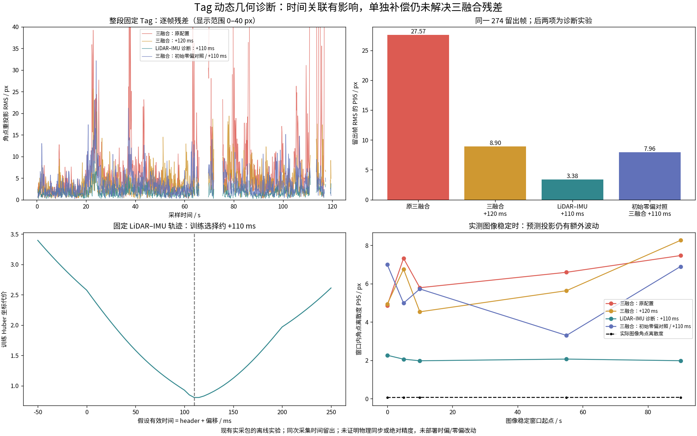

# Tag 动态几何误差：时间与前端融合对照

日期：2026-11-04。用户要求继续排查，并表示可以重新录包。本轮使用既有 120 秒包 `bags/fast-livo-tag140_sync_diag_02-35f_m8nd/`，没有启动设备、部署程序、修改正式标定、提交或推送。

**结论：有效时间偏移有明显影响；单独改时偏、或在已知静止的初始化段改用实测 gyro 均值，都不足以消除三融合轨迹的不一致。** 不生成真实 VALID 地标。新增 LiDAR–IMU 诊断把影响范围缩小到时间关联和视觉融合相关路径，但没有证明单一根因，更没有以关闭图像作为正式修复。

## 1 输入与对照设计

- 同一个固定 tag36h11:1，打印后尺量黑边 0.140 m；沿用本次用户确认的固定部署与刚性安装。旧 0.155 m 实例不合并。
- 用户本轮补充“是同一场地，但旧的建图包里面没有tag”。[原话与范围](fast_livo2_evidence/tag_motion_geometry_20261104/user_site_declaration.json)归档：确认同一场地，不代替旧图完整覆盖、独立位姿真值或 Tag 登记。旧图没有 Tag 扩展不妨碍纯 LiDAR C2，也不需要因此重建。
- 图像模型、畸变、相机–IMU 外参、Tag 尺寸固定；所有对照只拟合各自坐标系中的一个固定 Tag 位姿，不同时优化轨迹/外参来降低残差。
- 共同 1061 帧；相同 103 个训练帧、274 个时间留出帧，边界清除及训练降采样沿用已有工具。同次采集时间留出不代表独立访问。
- 初始双解有界种子最多 4 支；种子、时偏只按训练目标选择，不用留出分数选择。仍不能据此声称穷尽所有物理模式。

新增工具 [diagnose_motion_geometry.py](../scripts/fast_livo2/tags/diagnose_motion_geometry.py)默认 dry-run、只读输入、新输出目录；显式 `--cohort` 固定比较图像身份，缺支持直接失败。除整段拟合外，另在 5 秒块内用前段拟合、后段验证，中间至少 0.5 秒间隔；这些局部 Tag 位姿仅作诊断，不拼成地标表。

## 2 LiDAR–IMU 对照与时偏扫描

现有前端本来提供 `ONLY_LIO` 分支。本轮复制已锁定且已审查的当前源码至 `ws_fast_livo/motion_diag_source_20261104/`，独立构建 `ws_fast_livo/build_motion_diag_20261104/`，没有 install。新增[诊断 harness](fast_livo2_evidence/tag_motion_geometry_20261104/replay_lio_diagnostic.cpp)调用原同步、去畸变和状态估计，仅输出诊断状态 JSONL，不把它冒充原 VIO 后云/位姿契约。图像关闭的这组输出不是三融合验收。

LiDAR–IMU 轨迹固定后，检查 header + offset，网格 −50 到 +250 ms、步长 5 ms。每个网格使用相同图像、模型、训练/留出集合。训练 Huber 代价最低为 +110 ms，+115 ms 的训练代价与其接近（0.80715 / 0.80750），不报告 5 ms 精确标定。完整 [时偏扫描](../outputs/fast-livo-tag140-motion-geometry-20261104/time_sweep/summary.json)保留。

| 固定轨迹/重放条件 | 留出 RMS 中位数 / px | 留出 RMS P95 / px | 全共同集合通过原始试验门槛¹ |
| --- | ---: | ---: | ---: |
| 原三融合，0 ms | 4.427 | 27.569 | 383/1061 |
| 原三融合，+120 ms | 3.279 | 8.896 | 489/1061 |
| 原三融合，新增 +110 ms 重放 | 3.695 | 9.043 | 396/1061 |
| LiDAR–IMU 诊断，0 ms | 1.992 | 56.396 | 754/1061 |
| LiDAR–IMU 诊断，+120 ms | 1.560 | 5.135 | 905/1061 |
| LiDAR–IMU 诊断，+110 ms | 1.575 | 3.377 | 932/1061 |

¹ RMS≤3 px 且最大角点残差≤6 px、正深度；这是原有未实测标定的初始检查，不是绝对精度或安全认证。分母含训练及其他共同帧；留出统计单列，不混为独立成功次数。

新 +110 ms 三融合重放有 1195 对 VIO 后位姿/云、5759 次视觉更新、一次初始重力对齐，退出 0。它没有比已有 +120 ms 显示出一致优势，因此不把更细网格最低点直接部署。

LiDAR–IMU 和三融合的测量更新时刻/扫描分段也不同；这是有用的消融对照，不足以把所有分数差异唯一归因于视觉残差实现。短块内三融合 +120 ms 留出 P95 的中位数仍约 7.17 px，不能只用“整段积累漂移”解释或通过分段拼图掩盖。

## 3 初始化零偏检查

源码 `ImuProcess::IMU_init` 更新 `mean_gyr`，但实际执行 `state_inout.bias_g = Zero3d`。已独立测量的初始图像稳定片段中 gyro 均值明显非零，约 `[0.02960,-0.01208,-0.02550] rad/s`；原轨迹到约 119 秒的估计才接近 `[0.02484,-0.00998,-0.02160] rad/s`。这说明零偏初始假设值得检查，不代表所有运动初始化都应直接取均值。

仅在隔离副本中替换为已有初始化均值；没有硬编码本包数值，也没有修改原 frontend/vendor/补丁/安装二进制。[单行差异及前提](fast_livo2_evidence/tag_motion_geometry_20261104/bias_ablation.json)与原源码、原实验二进制已归档。该实验依赖本包初始化段已被图像验证稳定；对运动初始化不适用，不能自动推广为生产初始化策略。

| 实验初始化条件 | 留出 RMS 中位数 / px | 留出 RMS P95 / px | 原试验门槛通过 |
| --- | ---: | ---: | ---: |
| 均值零偏，三融合 0 ms | 3.769 | 24.094 | 411/1061 |
| 均值零偏，三融合 +110 ms | 2.687 | 7.962 | 561/1061 |
| 均值零偏，LiDAR–IMU +110 ms | 1.432 | 3.565 | 951/1061 |

有些指标改善，有些尾部指标没有改善；**不能认定“初始化零偏是唯一根因”或“问题已修复”。** 每个重放条件只运行一次，未据此作统计显著性或重复性结论。3 次重放均退出 0，其中两次三融合各 1195 对、一次 LiDAR–IMU 1198 个诊断状态。[实际 argv/退出码/耗时/二进制 SHA](fast_livo2_evidence/tag_motion_geometry_20261104/bias_runs.json)。

## 4 图像稳定片段

只按实测四角离散度选 5 秒窗：至少 45 帧，角点相对中位数 RMS 的 P95≤0.2 px、最大≤0.5 px；不是根据用户原动作时间表划分。实际得到起点 0、5、10、55、90 秒的 5 个窗口。

- 实际图像角点离散度 P95 约 0.063–0.070 px。
- 原三融合 0 ms 的预测角点离散度 P95 约 4.86–7.46 px。
- LiDAR–IMU +110 ms 的预测角点离散度 P95 约 1.98–2.27 px。

固定外参/固定 Tag 位姿可造成常量投影偏差；这些窗口中的额外时变投影波动不能仅靠一个常量偏移解释。它仍可能包含前端状态噪声、场景/光度约束及扫描分段影响，不把图像稳定性当独立六自由度真值。下一份数据应明确分开平移、转向、停稳，并保持背景静态，以继续区分影响来源。[逐窗口原统计](fast_livo2_evidence/tag_motion_geometry_20261104/static_windows.json)。

## 5 实际命令、检查与限制

证据目录：`docs/fast_livo2_evidence/tag_motion_geometry_20261104/`；大输出：`outputs/fast-livo-tag140-motion-geometry-20261104/`。shell 环境为 ROS Humble、localhost、隔离 domain 195；所有轨迹输入读取原始 bag 或已有派生 bag，没有向底盘或公共定位入口提交。

| 实际检查/执行 | 结果 | 日志 |
| --- | --- | --- |
| 首次 configure/build：误用不存在的 deps setup，缺 vikit prefix | 退出 2；环境失败保留，非算法失败 | `configure.log`、`build.log` |
| 显式 `-DCMAKE_PREFIX_PATH=.../deps_install` configure + 诊断构建 | 退出 0 | `configure_retry.log`、`build_retry.log` |
| 原初始化 LiDAR–IMU 重放 / +110 ms 三融合重放 | 均退出 0；1198 状态 / 1195 对 | 输出下 `lio.log`、`livo_selected.log` |
| 固定 LiDAR–IMU 时偏网格、共同集合分析、零偏对照分析、绘图 | 均退出 0 | `time_sweep.log`、`compare_final.log`、`compare_bias.log`、`plot.log` |
| 隔离零偏副本构建与 3 次重放 | 均退出 0 | `build_bias.log`、`bias_runs.json` |
| 新独立投影/局部诊断测试 | 3/3，退出 0 | `tests_final.log` |
| 相关既有时间/投影回归 | 5/5，退出 0 | `consistency_tests.log` |

可重算入口：先 `source /opt/ros/humble/setup.bash`；轨迹几何脚本用显式 `--execute --observations ... --config ... --cases ... --cohort ... --output <新目录>`，本次参数文件与命令记录保留在证据目录。实验 runner 默认 dry-run；重新执行须使用新的输出目录，不能覆盖本次证据。

原 DB 的完整 SHA 仍为 `753c9b4af470821d190c0187d920d9412a70f52ab774ff0adddec5e3d04589d2`。正式 trial 配置、原 IMU 源码、安装版 mapping/replay 二进制 SHA 与先前基线一致，见 [源资产验证](fast_livo2_evidence/tag_motion_geometry_20261104/source_verification.json)。

**PASS：** 隔离构建、5 次新增重放、共同集合/时间扫描/静态诊断、新 3 项与相关 5 项测试、输入保护。**PARTIAL：** 剩余视觉融合相关误差根因、有效时偏和不确定性、跨访问泛化、实际全局位置/绝对精度。**未实施：** 真实 VALID Tag 表、实机时偏/零偏/外参变更、关闭生产图像融合、公共桥接接管、硬件、Git 提交/推送。

## 6 下一步与最少人工数据

现有记录能够证明影响存在，但同次采集不能验证所选时间假设能否推广；尚缺分离平移/转向且包含明确停稳的独立访问。用户已表示可重录；准备两份 90 秒包，见 [录包说明](fast_livo2_recording.md#新一轮分离动作诊断2026-11-04)。不用重印或改尺寸，不改安装、曝光、标定或正式时偏；命令前就停稳。每包只做一种动作，前后各静止约 20 秒，中间动作后停稳，背景尽量保持不变。

收到后先用第一份估计/检查，第二份只作独立条件验证；若两种运动的时偏/几何解释不兼容，就拒绝登记并进一步定位，不能再次根据第二份分数调参后称其独立验收。只有时间映射/几何得到可用证据后，才进行 C1 旧图补录和独立 Tag C2 恢复。整层建图暂不作为解决本问题的前置工作。

## 7 用户询问的实际波动量（2026-11-04 补充）

复用已有当前源码重放，没有重新运行前端。每帧取本图像 pixel RMSE 最小的姿态支路，计算 `T_O_F = X(tc+offset)*T_I_C*T_C_F`；不根据地图参考位姿选择分支。参考为原 103 个训练帧拟合出的同一个固定 Tag 位姿，分别计算位置的三维欧氏距离和 SO(3) 最短旋转角。参考不是独立真值；主支路散布同时包含前端、相机/时间和 PnP 歧义，不能据此报告机器人绝对定位精度。

全共同集合为 **1061 帧**，含静止与运动：

| 相对固定拟合参考的偏离 | 三融合 0 ms | 三融合 +120 ms 实验 |
| --- | ---: | ---: |
| 位置偏离中位数 | 0.54 cm | 0.40 cm |
| 位置偏离 P95 | 2.70 cm | 1.21 cm |
| 最大位置偏离 | 12.35 cm | 7.09 cm |
| 朝向偏离 P95 | 2.29° | 1.64° |
| 最大朝向偏离 | 16.96° | 16.35° |
| 最远两帧位置之差 | 17.72 cm | 8.63 cm |

最大值来自少量离群观测；最大角度含平面 PnP 分支影响，不是车实际抖动该角度。+120 ms 仍是隔离实验，没有写入实机配置。

单列原 **274 个留出帧**：0 ms 的位置偏离中位/P95/最大为 **0.51/3.28/10.44 cm**，+120 ms 为 **0.45/1.38/3.42 cm**。不要把全集合最大值与留出误差混成同一个统计。

原 5 个图像稳定窗口（各约 5 秒）中，三融合 0 ms 每窗最远两帧推算位置相差约 **1.15–1.34 cm**，朝向最大两帧差约 **0.64–1.03°**；这些是窗口内相对变化。它与“相对整段固定参考的偏离”定义不同。LiDAR–IMU +110 ms 诊断的全集合位置 P95 约 **0.43 cm**，但这组关闭图像，仅用于定位误差来源。

[计算脚本](fast_livo2_evidence/tag_motion_geometry_20261104/pose_spread.py)、[完整统计和来源 SHA](fast_livo2_evidence/tag_motion_geometry_20261104/pose_spread.json)、[执行日志](fast_livo2_evidence/tag_motion_geometry_20261104/pose_spread.log)与[独立 5 cm / 30° 数值校验](fast_livo2_evidence/tag_motion_geometry_20261104/pose_spread_verification.json)保留，执行退出 0。无硬件、配置、地标或验收状态变更。
